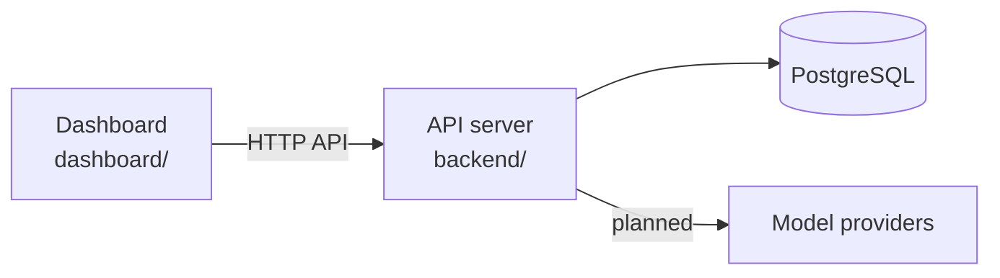

# Nextsci Agents

**Open-source platform for building, running, and inspecting AI agents.**

Define an agent on the web: its model, instructions, tools, and knowledge. The server runs it. Follow every step of each run, with its tool calls and token use.

> [!NOTE]
> The project is at an early stage. The API server and the dashboard run and talk to PostgreSQL, and the dashboard has sign-in and an empty shell, but no agent features exist yet.

## Architecture

The project is a monorepo of independent apps. Each app has its own dependencies and lockfile. A self-hosted deployment runs the API server, the dashboard, and PostgreSQL.



| App | Path | Stack | Dev URL |
| --- | --- | --- | --- |
| API server | [`backend/`](backend/) | Django 6.1, Django REST framework, JWT auth, Python 3.12 | http://localhost:8000 |
| Dashboard | [`dashboard/`](dashboard/) | React 19, TypeScript, Vite 8, TanStack Router and Query, shadcn/ui | http://localhost:5174 |
| Database | [`compose.yaml`](compose.yaml) | PostgreSQL 17 | `localhost:5432` |

## Quick start

With [moon](https://moonrepo.dev), Python 3.12, Node.js 22, and a running PostgreSQL 17 server:

```bash
cp .env.example .env          # set the POSTGRES_* values
createdb -h localhost -U postgres nextsci_agents
moon run backend:createsuperuser
moon run :dev
```

Open http://localhost:5174 and sign in with the email and password you just created. To add accounts for your team, follow [Create the master admin and sign in](docs/admin.md).

To run everything in Docker instead: `cp .env.example .env && docker compose up --build`, then `docker compose exec backend python manage.py createsuperuser`.

## Develop

- [`AGENTS.md`](AGENTS.md) lists the layout and every command. [`CLAUDE.md`](CLAUDE.md) loads it for Claude Code.
- [`.agents/`](.agents/) holds the rules for each area, how to verify a change, and lessons learned.
- [`DESIGNS.md`](DESIGNS.md) is the design system.
- Run `./scripts/check.sh` before you open a pull request.

## Roadmap

The items below are planned. None of them exist yet.

- [ ] Model providers and encrypted API keys
- [ ] Tool definitions with JSON schemas, and MCP servers
- [ ] Agent definitions: model, instructions, tools, and knowledge
- [ ] The agent runtime loop, with step limits and streaming
- [ ] Run history with every step, tool call, token count, and cost
- [ ] Knowledge bases with document upload and retrieval
- [ ] Evals: datasets, graders, and scores per agent version
